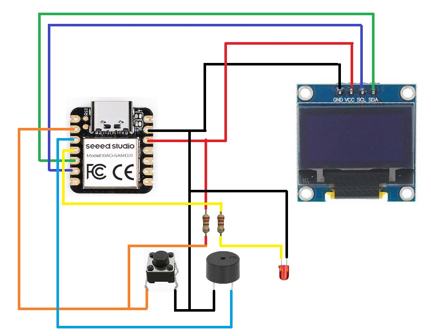

# Temporizador con 1 botón — XIAO SAMD21 + OLED 0.96"

Temporizador de minutos que se controla con un solo botón. Muestra el tiempo en una pantalla OLED y, al terminar, avisa con un buzzer y un LED intermitentes.

El código está en [Temporizador/Temporizador.ino](Temporizador/Temporizador.ino).

---

## Hardware

| Componente | Detalle |
|---|---|
| Microcontrolador | Seeed Studio XIAO SAMD21 (antes "Seeeduino XIAO"), ATSAMD21G18 a 48 MHz, lógica de **3.3 V** |
| Pantalla | OLED 0.96" 128×64 I2C de 4 pines, controlador **SSD1315** (compatible con SSD1306), dirección `0x3C` |
| Botón | Pulsador normalmente abierto |
| Buzzer | Activo o pasivo |
| LED | LED de 3 mm o 5 mm + resistencia de 220 Ω |

### Conexiones

| Componente | Pin del componente | Pin del XIAO |
|---|---|---|
| OLED | VCC | 3V3 |
| OLED | GND | GND |
| OLED | SDA | **D4** |
| OLED | SCL | **D5** |
| Botón | Patita 1 | **D1** |
| Botón | Patita 2 | GND |
| Buzzer | + | **D2** |
| Buzzer | − | GND |
| LED | Ánodo (patita larga) | **D3**, a través de una resistencia de 220 Ω |
| LED | Cátodo (patita corta) | GND |

 


### Precauciones

- **Los pines del XIAO aceptan como máximo 3.3 V.** No conectes 5 V a ningún pin de entrada o salida.
- **El botón se activa con 0 V.** El pin D1 usa la resistencia pull-up interna: queda en 3.3 V con el botón suelto y pasa a 0 V al presionarlo. Por eso el botón va entre D1 y GND, sin resistencia externa.
- **Buzzer y corriente:** un pin del SAMD21 entrega poca corriente (unos 7 mA). Si el buzzer consume más, conéctalo con un transistor NPN (2N2222 o BC547):
  - D2 → resistencia de 1 kΩ → base del transistor
  - Emisor → GND
  - Buzzer entre 3V3 (o 5V) y el colector
- **D4 y D5 son el bus I2C del XIAO.** No los uses para otra cosa.

---

## Funcionamiento

```
 REPOSO ──(presionar)──► SELECCIÓN ──(3 s sin tocar)──► CUENTA ATRÁS ──(llega a 0)──► ALARMA
   ▲                                                         │                          │
   └────────────────(mantener 2 s: cancelar)─────────────────┘                          │
   └──────────────────────────(botón o 5 s)─────────────────────────────────────────────┘
```

1. **Reposo:** la pantalla está apagada.
2. **Selección:** la primera pulsación enciende la pantalla y muestra **5**.
   - **Pulsación corta:** avanza 5 → 10 → 15 → 20 → 5…
   - **Mantener 2 s después de elegir 5, 10 o 15:** sube **+1** cada 300 ms hasta soltar.
   - **Mantener 2 s después de elegir 20:** sube **+5** cada 300 ms hasta soltar.
   - **Pulsación corta después de un ajuste:** salta al siguiente valor de la lista. Por ejemplo, de 17 pasa a 20, y desde 20 o más vuelve a 5.
3. **Cuenta atrás:** empieza sola cuando pasan **3 s sin tocar el botón**. Cada unidad equivale a **1 minuto**. La pantalla muestra `MM:SS` (o `H:MM:SS` desde una hora) y una barra de progreso.
   - Mantener el botón 2 s **cancela** la cuenta y vuelve a reposo.
4. **Alarma:** el buzzer y el LED parpadean juntos. Se detienen al presionar el botón o a los **5 s**. La pantalla queda apagada.

### Parámetros configurables

Están como constantes al inicio del sketch:

| Constante | Valor | Para qué sirve |
|---|---|---|
| `PIN_BOTON_TEMP` / `PIN_BUZZER_TEMP` / `PIN_LED_ALARMA` | 1 / 2 / 3 | Pines del botón, el buzzer y el LED |
| `OLED_DIRECCION` | `0x3C` | Dirección I2C de la pantalla (algunos módulos usan `0x3D`) |
| `PRESETS` | 5, 10, 15, 20 | Valores que recorre la pulsación corta |
| `VALOR_MAXIMO` | 995 | Máximo de minutos seleccionables |
| `TIEMPO_PULSO_LARGO` | 2000 ms | Tiempo que hay que mantener el botón para empezar a incrementar o para cancelar |
| `TIEMPO_REPETICION` | 300 ms | Velocidad del incremento mientras se mantiene el botón |
| `TIEMPO_CONFIRMACION` | 3000 ms | Tiempo sin tocar el botón para que empiece la cuenta |
| `DURACION_ALARMA` | 5000 ms | Duración máxima de la alarma |
| `PERIODO_PARPADEO` | 250 ms | Ritmo de parpadeo del buzzer y el LED |
| `FRECUENCIA_BUZZER` | 2700 Hz | Tono del buzzer (con buzzer pasivo) |
| `MS_POR_UNIDAD` | 60000 | Duración de cada unidad. Ponlo en `1000` para probar con segundos en vez de minutos. |

---

## Configuración del Arduino IDE

### 1. Instalar el soporte para la placa

1. Abre **Archivo → Preferencias**.
2. En **Gestor de URLs adicionales de tarjetas** agrega:
   ```
   https://files.seeedstudio.com/arduino/package_seeeduino_boards_index.json
   https://siliconlabs.github.io/arduino/package_arduinosilabs_index.json
   ```
3. Abre **Herramientas → Placa → Gestor de tarjetas**
4. Instalar **"Seeed LabsS"**
5. Luego busca **"Seeed SAMD"** e instala **Seeed SAMD Boards**. Este proyecto se probó con la versión 1.8.6.

### 2. Instalar las librerías

Abre **Programa → Incluir librería → Administrar bibliotecas** e instala estas tres:

| Librería | Versión probada |
|---|---|
| Adafruit SSD1306 | 2.5.17 |
| Adafruit GFX Library | 1.12.6 |
| Adafruit BusIO | 1.17.4 (el IDE la ofrece al instalar las otras) |

`Wire` y `SPI` ya vienen incluidas en el core de Seeed.

### 3. Seleccionar placa y puerto

- **Herramientas → Placa → Seeed SAMD Boards→ Seeeduino XIAO**
- **Herramientas → Puerto:** el COM que aparece al conectar el XIAO

Deja las demás opciones de **Herramientas** con sus valores por defecto:

| Opción | Valor |
|---|---|
| USB Stack | Arduino |
| Debug | Off |
| SERCOM4 | Include |
| TX/RX LED | On |

### 4. Compilar y subir

Abre `Temporizador/Temporizador.ino`. El archivo tiene que estar dentro de una carpeta con su mismo nombre. Después presiona **Subir**.

---

## Solución de problemas

| Síntoma | Causa | Solución |
|---|---|---|
| `No DFU capable USB device available` / `exit status 74` | Está elegida una placa que se programa por DFU, como Arduino Nano ESP32 o UNO R4. El XIAO SAMD21 se programa con `bossac`, no con DFU. | Elige **Seeeduino XIAO** en el menú de placas. |
| `expected unqualified-id before numeric constant` en `PIN_LED` | El core del XIAO ya define las macros `PIN_LED`, `LED_BUILTIN`, etc. | No uses esos nombres para tus constantes. El sketch usa `PIN_LED_ALARMA`. |
| No aparece el puerto COM | Cable USB que solo carga, o placa colgada | Usa un cable USB-C **de datos**. Si no basta, entra al modo bootloader (fila siguiente). |
| La subida falla o la placa no responde | El programa cargado bloquea el USB | **Modo bootloader:** une con un cable **dos veces seguidas y rápido** los pads **RST** junto al USB-C. El LED naranja empieza a pulsar y aparece un COM nuevo. Elige ese puerto y vuelve a subir. |
| El LED parpadea rápido y la pantalla no enciende | El sketch no encuentra la OLED | Revisa SDA en D4, SCL en D5 y la alimentación en 3V3. Prueba `OLED_DIRECCION = 0x3D`. |
| El botón no responde o hace cosas solo | Botón mal cableado | El botón va entre **D1 y GND**, nunca a 3V3 o 5V. |
| El buzzer suena muy bajo o no suena | Falta corriente | Usa el transistor NPN descrito en [Precauciones](#precauciones). |
| El log del IDE es enorme y no se entiende | Está activado el modo detallado | El error real está siempre en las **últimas líneas** del log. Para un log más corto, desactiva **Archivo → Preferencias → Mostrar salida detallada durante la compilación**. |

---

## Estructura del proyecto

```
Sp32-Temporizador/
├── README.md                                   ← este archivo
├── XIAO_SAMD21.md                              ← detalle micro procesador SAMD21
├── PrimerosPasosXIAO_SAMD21.md                 ← ejemplo de uso
├── Oled0,96_I2c.md                             ← detalle display oled
├── Temporizador/
│   └── Temporizador.ino                        ← programa
├── XIAO SAMD21.md                              ← documentación de la placa (Seeed Wiki)
├── Oled0,96_I2c.md                             ← ficha de la pantalla
├── xiao-pinout-samd21.jpg                      ← pinout de la SAM21
├── Diagrama.jpg                                ← diagrama esquematico
└── Disply.jpg                                  ← pinout de la pantalla
```

## Referencias

- [Wiki XIAO SAMD21](XIAO_SAMD21.md)
- [Wiki de Seeed Studio XIAO SAMD21](PrimerosPasosXIAO_SAMD21.md)
- [Pantalla Oled 0,96 I2c 4 Pines 128x64](Oled0,96_I2c.md)
- [Librería Adafruit SSD1306](https://github.com/adafruit/Adafruit_SSD1306)
- [Librería Adafruit GFX](https://github.com/adafruit/Adafruit-GFX-Library)
